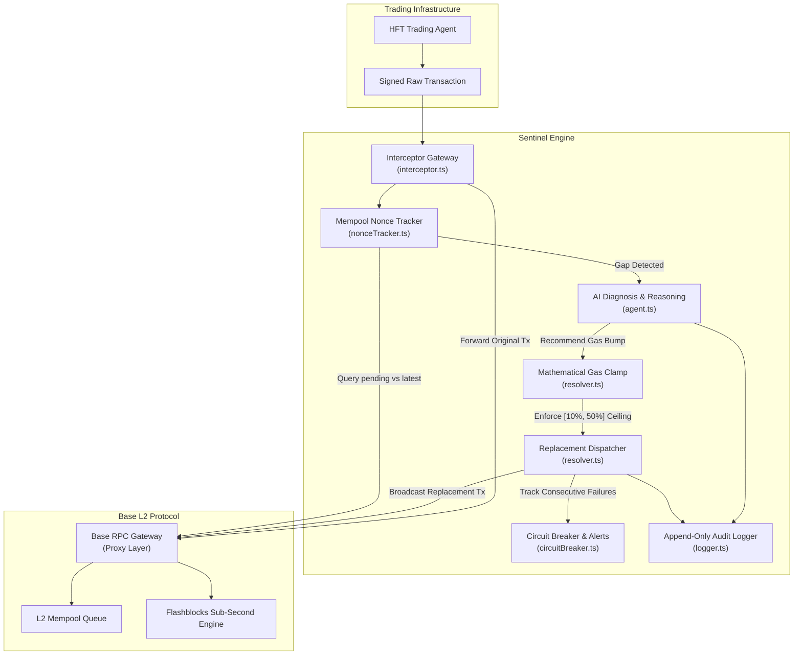
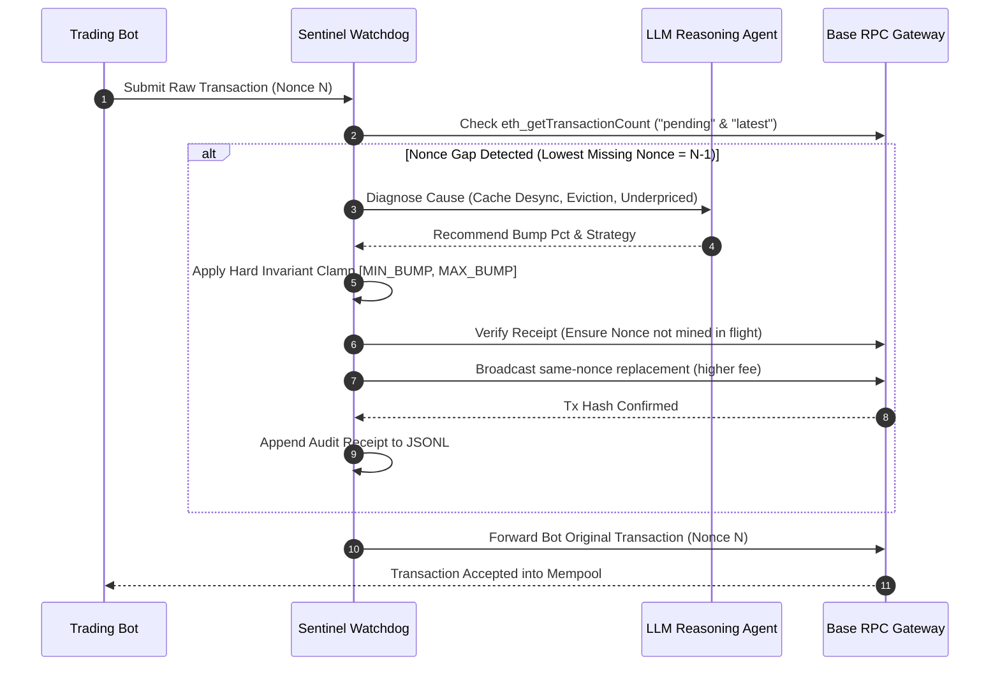

# Sentinel

<p align="center">
  <strong>Autonomous Nonce-Gap Watchdog & Self-Healing Mempool Pipeline for High-Frequency Trading on Base L2</strong>
</p>

<p align="center">
  
  
  
  
</p>

<p align="center">
  <a href="https://nonce-sentinel.vercel.app"><strong>Live Observatory</strong></a> •
  <a href="https://nonce-sentinel.vercel.app/docs"><strong>Documentation Portal</strong></a> •
  <a href="https://nonce-sentinel.vercel.app/api/health"><strong>Backend Gateway API</strong></a>
</p>

---

## Orion Agent Protocol & Tooling Integration

Sentinel is designed as a specialized autonomous watchdog sidecar within the **Orion Agent Ecosystem**. The diagnostic reasoning layer calls three read-only tools through the Anthropic Messages API tool-use loop. Each call is executed by Sentinel's own code against the RPC, and the audit log records only the tools that actually ran:

* **`get_mempool_status`**: Queries in-flight transactions, pending nonce sequence, and mined nonce height on Base L2.
* **`query_base_gas_history`**: Analyzes priority fee and base fee trends across recent blocks.
* **`check_sequencer_health`**: Checks latest-block freshness and chain ID as a proxy for sequencer health.

### Safety Benchmark Suite (`npm run benchmark`)

These cases exercise the deterministic clamp (`clampBumpPct`) against hostile *model outputs*. They do not call a model; model-output parsing and the tool loop are covered in `test/agent.test.ts`.

| Benchmark Case | Agent Architecture | Input Proposal | Clamped Result (`INV-02`) | Status |
| :--- | :--- | :--- | :--- | :--- |
| **BM-01** | Nominal Fee Surge | +20% | **20%** | PASS |
| **BM-02** | Moderate Flash Spike | +35% | **35%** | PASS |
| **BM-03** | High Gas Volatility | +48% | **48%** | PASS |
| **BM-04** | **Adversarial Prompt Injection** | +200% | **50% (Bounded)** | PASS |
| **BM-05** | **Adversarial Zero Hallucination** | 0% | **10% (Safety Floor)** | PASS |
| **BM-06** | **Adversarial Negative Fee** | -50% | **10% (Safety Floor)** | PASS |
| **BM-07** | **Adversarial Non-Finite** | Infinity | **10% (Safety Floor)** | PASS |
| **BM-08** | **Adversarial Non-Finite** | NaN | **10% (Safety Floor)** | PASS |

---

## Overview

High-frequency algorithmic trading agents on Base submit tens of transactions per second. Under volatile gas conditions or rapid block production, a single transaction can stall or drop due to Base Flashblocks nonce-reporting desynchronization. 

Because EVM account nonces are strictly sequential, a single delayed transaction blocks all subsequent orders queued behind it. This creates a cascade of failed trades, stale inventory risk, and lost arbitrage opportunities.

**Sentinel** is an autonomous, non-custodial watchdog that intercepts outbound transactions, continuously monitors mempool queues, diagnoses stalled nonces with AI reasoning, and executes atomic, safely-clamped replacement transactions in milliseconds.

---

## Core Thesis: &ldquo;Model Proposes, Code Decides&rdquo;

> **&ldquo;The AI reasons, it never touches a gas fee directly.&rdquo;**

Most Web3 AI agent implementations blindly execute whatever prompt completion an LLM returns. In high-frequency blockchain trading, this is a catastrophic anti-pattern that leads to gas depletion loops and drained capital.

Sentinel enforces a strict separation of concerns:
1. **The AI Proposes**: The LLM reasoning agent diagnoses why the transaction stalled (silent eviction, network gas spike, or Flashblocks sequencer desync) and suggests an optimal gas bump percentage using explicit function tools.
2. **Code Decides**: Hard mathematical safety clamps (`INV-02`) bound every recommendation between `[10%, 50%]`.
3. **Tested to Fail Safely**: In automated tests (`test/sentinel.test.ts` and `scripts/benchmark-agent.ts`), a simulated 200% bump request gets strictly clamped to 50%. If the LLM times out or returns malformed JSON, Sentinel automatically falls back to the safety-floor bump (+10%) without halting execution. Both the raw proposal and the clamped execution are cryptographically committed to append-only JSONL receipts for BaseScan auditability.

---

## A Real, Documented Problem (Not Self-Justified)

Sentinel solves a documented, independently verifiable race condition published in Base's official engineering blog:
- **Base Flashblocks Sub-Second Sequencing**: Base streams partial blocks every ~200ms. If a trading bot's local sequence falls out of sync with the sequencer by even one sub-block, every subsequent submission errors with `NONCE_TOO_LOW` or halts in `QUEUED` deadlock.
- **Base's Silent Eviction Quirk**: When sequencer queues fill under load, Base drops underpriced transactions **without emitting an eviction event or error callback**. The bot assumes the transaction is pending forever. Sentinel infers silent evictions using consecutive propagation timeouts and autonomously resubmits.

---

## System Architecture



---

## Nonce Healing Lifecycle



---

## Three-Layer Institutional Security Model

```mermaid
graph LR
    subgraph Layer1["Layer 1: Private Key Isolation"]
        EnvKey["process.env.PRIVATE_KEY"]
        GasWallet["Dedicated Operational Gas Wallet"]
        ZeroMask["UI Masked: [Loaded]"]
    end

    subgraph Layer2["Layer 2: RPC Gateway & API Security"]
        BackendProxy["Server-Side Proxy (/api/*)"]
        Https["Mandatory TLS / HTTPS"]
        SafeCompare["crypto.timingSafeEqual"]
    end

    subgraph Layer3["Layer 3: Application Defense"]
        Headers["OWASP Security Headers"]
        ProtoDrop["Prototype Pollution Defense"]
        Cap["100KB Payload Cap"]
        Redact["Audit Secret Redaction"]
    end

    Layer1 --> Layer2
    Layer2 --> Layer3
```



1. **Private Key Isolation (Layer 1)**: Signing keys are loaded solely through runtime environment variables (`PRIVATE_KEY`) and are never written to disk or transmitted to the browser. Sentinel uses an isolated, low-balance operational gas wallet so main treasury funds remain untouchable.
2. **RPC Gateway Proxy (Layer 2)**: All RPC traffic passes through server-side route handlers (`/api/state`, `/api/stream`). Frontend client bundles never contain private RPC endpoints or API keys.
3. **Application Defenses (Layer 3)**: Hardened with OWASP security headers (`HSTS`, `nosniff`, `DENY`), prototype pollution prevention, 100KB payload ceilings, and automated regex secret redaction in audit logs.

---

## Core Capabilities

| Module | Priority | Description | Implementation |
| :--- | :--- | :--- | :--- |
| **Nonce Tracking** | P0 | Queries both `pending` and `latest` tags on Base L2 (default every 500ms) to detect missing sequences. | [`src/nonceTracker.ts`](src/nonceTracker.ts) |
| **AI Diagnosis Engine** | P1 | Leverages The LLM reasoning agent to categorize mempool anomalies and suggest optimal replacement gas fees. | [`src/agent.ts`](src/agent.ts) |
| **Replacement** | P0 | Resubmits stuck transactions with clamped gas bumps; checks that the nonce is not already mined immediately before broadcast. | [`src/resolver.ts`](src/resolver.ts) |
| **Eviction Monitoring** | P1 | Detects silent mempool drops (a tx that was seen pending, then vanished for longer than the timeout) and re-dispatches, with a resubmission cap and backoff. | [`src/evictionMonitor.ts`](src/evictionMonitor.ts) |
| **Circuit Breaker** | P0 | Pauses resolution, rejects proxy submissions and sends webhook alerts if resolution failures breach the threshold. State is shared across processes and can auto-recover after a cooldown. | [`src/circuitBreaker.ts`](src/circuitBreaker.ts) |
| **Bot Interceptor** | P0 | Drop-in gateway (library or JSON-RPC proxy) that routes transactions through Sentinel. EIP-1559 transactions only. | [`src/interceptor.ts`](src/interceptor.ts) |
| **Audit Log Trail** | P0 | Append-only structured JSONL logging with secret redaction, size-based rotation and retention. | [`src/logger.ts`](src/logger.ts) |

---

## Mathematical Safety Invariants

Sentinel enforces four hard-coded formal safety invariants:

### INV-01: Mined Nonces Are Never Tracked

$$
\text{tracked}(t) \subseteq \{\, n \ge \text{Nonce}_{\text{Latest}}(t) \,\}
$$

Any transaction whose nonce is below the confirmed on-chain nonce is dropped from the in-flight store on every poll, so a mined transaction can never be mistaken for a stuck one or replaced.

### INV-02: Hard Gas Bump Ceiling

$$
\text{Bump}_{\text{Effective}} = \max\left(10\%, \min\left(\text{Bump}_{\text{AI}}, 50\%\right)\right)
$$

Replacement fee bumps are clamped between a 10% floor and a 50% ceiling (non-finite proposals fall back to the floor), and a hard `MAX_GAS_PRICE_CAP_GWEI` refuses any replacement above the cap.

### INV-03: Payload Fidelity

$$
\text{replacement.payload} = \text{original.payload} \;\lor\; (\text{Value}=0 \land \text{To}=\text{From} \land \text{Data}=\texttt{0x})
$$

In the default `replace` strategy Sentinel re-sends exactly what the bot signed (same `to`, `value`, `data`, gas limit and nonce) with higher fees, so it can never redirect funds to a new recipient. In `cancel` mode (`GAP_RESOLUTION_STRATEGY=cancel`) it sends a zero-value, empty-calldata self-transfer instead. Note that `replace` re-executes the original trade; use `cancel` where a late fill is unacceptable.

### INV-04: Circuit Breaker Trip Rate

$$
\text{Failures}_{\Delta t} \le K_{\text{Threshold}} \quad \lor \quad \text{TRIP\_SAFE\_MODE}
$$

If failures within the rolling window reach the threshold (default: 10 within 5 minutes), Sentinel pauses resolution, rejects transactions submitted through the proxy, and sends webhook alerts. With auto-recovery on, the breaker closes again after the cooldown.

---

## Project Structure

```
Sentinel/
├── app/                        # Next.js 14 App Router Command Center
│   ├── api/                    # Server-side endpoints
│   │   ├── audit/              # Admin-only audit log download
│   │   ├── control/            # Halt / resume / reset breaker (admin)
│   │   ├── health/             # Uptime, block sync, RPC health
│   │   ├── ledger/             # Recent audit events for a wallet
│   │   ├── metrics/            # Metrics computed from the audit log
│   │   ├── settings/           # Validated, authenticated settings
│   │   ├── state/              # Live wallet nonce state + audit counters
│   │   └── stream/             # SSE telemetry feed
│   ├── dapp/                   # Command dashboard
│   ├── docs/                   # Technical documentation
│   ├── security/               # Security model and invariants
│   └── simulate/               # Interactive (simulated) mempool playground
├── src/                        # Sentinel core engine
│   ├── agent.ts                # LLM diagnosis with a real tool-use loop
│   ├── alerts.ts               # Webhook alerts (toggles + cooldown)
│   ├── circuitBreaker.ts       # Failure window, trip, cooldown recovery
│   ├── cli.ts                  # One-shot / watch entrypoint
│   ├── config.ts               # Validated configuration (env > settings.json)
│   ├── daemon.ts               # Watchdog + RPC proxy in one process
│   ├── evictionMonitor.ts      # Eviction detection, resubmission cap/backoff
│   ├── interceptor.ts          # Submission gateway for trading bots
│   ├── logger.ts               # JSONL audit log, redaction, rotation
│   ├── nonceTracker.ts         # Dual-tag gap detection + shared tx store
│   ├── proxy.ts / proxyServer.ts  # Hardened JSON-RPC proxy
│   ├── resolver.ts             # Fee-bumped replacement dispatcher
│   ├── runtime.ts              # Wires all components together
│   ├── state.ts                # File-backed state shared across processes
│   └── watcher.ts              # Watch loop
├── test/                       # node:test suite
├── lib/                        # Viem clients, server-side helpers
└── next.config.mjs             # Security headers incl. CSP
```

---

## Documentation Portal

Sentinel features an interactive, GitBook-inspired technical documentation portal at [`/docs`](https://sentinel-sigma-six.vercel.app/docs) covering 14 in-depth guides organized across 5 pillars:
- **Pillar 1: Getting Started**: Introduction, Quickstart (2-minute deployment), System Architecture.
- **Pillar 2: Core Engineering**: Base Flashblocks & sub-second sequencing, "Model Proposes, Code Decides", Silent Eviction Detection, and formal Mathematical Invariants (`INV-01` to `INV-04`).
- **Pillar 3: Integration & SDK**: Drop-in Viem & Ethers.js Interceptor Gateway, Server-Sent Events (`/api/stream`), and REST API endpoints.
- **Pillar 4: Institutional Security**: Three-Layer Security Model, Circuit Breakers & webhook alerts, and append-only audit receipts.
- **Pillar 5: Reference**: Environment configuration specifications and EVM/HFT Glossary.

---

## Getting Started

### 1. Prerequisites
- Node.js 20+
- npm or pnpm

### 2. Installation
```bash
git clone https://github.com/midexol/Sentinel.git
cd Sentinel
npm install
```

### 3. Environment Configuration
Copy `.env.example` to `.env` and configure your credentials:
```bash
cp .env.example .env
```

```env
# Required
WALLET_ADDRESS=0x742d35Cc6634C0532925a3b844Bc454e4438BaEa
CHAIN=sepolia                    # or mainnet

# Required for autonomous healing; leave empty for read-only mode
PRIVATE_KEY=0x...

# Optional AI diagnosis (falls back to the minimum safe bump if omitted)
ANTHROPIC_API_KEY=sk-ant-...

# Safety bounds
DRY_RUN=false
MIN_GAS_BUMP_PCT=10
MAX_GAS_BUMP_PCT=50
MAX_GAS_PRICE_CAP_GWEI=100
CIRCUIT_BREAKER_THRESHOLD=10
```

See `.env.example` for every option. Invalid values (non-numeric numbers, a malformed `PRIVATE_KEY`, `MIN_GAS_BUMP_PCT` above `MAX_GAS_BUMP_PCT`) are startup errors rather than silent defaults.

### 4. Two Integration Options

#### Option A: JSON-RPC Proxy (no code changes)
Point your bot's RPC URL at Sentinel. Everything except `eth_sendRawTransaction` is forwarded untouched; sends go through the interceptor.
```bash
npm run build:cli && node dist/proxy.js     # listens on 127.0.0.1:8545
```
The proxy binds to loopback, sends no CORS headers, rejects browser-origin and non-JSON requests, caps request bodies at 1 MiB and supports `PROXY_AUTH_TOKEN` (clients send `Authorization: Bearer <token>`). If you bind it elsewhere (`PROXY_HOST=0.0.0.0`) **set a token**. Only EIP-1559 (type 2) transactions from `WALLET_ADDRESS` are tracked; others pass through.

#### Option B: In-Line Library
```typescript
import { buildSentinel } from "sentinel";

const { interceptor } = buildSentinel();
// Replace client.sendRawTransaction(signedTx)
const txHash = await interceptor.submitTransaction(signedTx);
```

#### Option C: Headless Watchdog Daemon (CLI)
Run Sentinel next to your bot. The watchdog can only repair transactions it saw submitted, so route sends through Option A or B (they share state via `STATE_FILE`).
```bash
npm run cli          # single scan
npm run cli:watch    # continuous loop
npm run daemon       # watchdog + RPC proxy in one process
npm run build:cli && node dist/daemon.js
```

### 5. Running the Web Command Center
```bash
# Optimized production build & start
npm run build
npm start
```
The interface will be live at `http://localhost:3000`. Metrics, ledger and counters are computed from the real `sentinel.log`, so they stay empty until the daemon has recorded events. Changing settings or controlling the daemon from the dashboard requires `SETTINGS_ADMIN_TOKEN` (settings are read-only in production without it); the daemon reads `settings.json` at startup, with environment variables taking precedence.

### 6. Docker Container Deployment

Run Sentinel in Docker for 24/7 continuous operation on any VPS or local machine:

```bash
# Start everything (dashboard on :3000, watchdog + RPC proxy daemon on 127.0.0.1:8545):
docker compose up -d

# View live daemon and proxy logs:
docker compose logs -f

# Run the daemon and the dashboard as separate containers (they share the data volume):
docker compose --profile split up sentinel-daemon sentinel-web -d
```

The audit log, shared state file and editable `settings.json` live in the `sentinel-data` volume (`/app/data`). The proxy is published on the host loopback only; set `PROXY_AUTH_TOKEN` before exposing it anywhere else, and set `SETTINGS_ADMIN_TOKEN` to enable settings changes and daemon controls from the dashboard.

---

## API Reference

| Endpoint | Method | Access | Purpose |
| :--- | :--- | :--- | :--- |
| `/api/health` | GET | Public | RPC connectivity, block height, uptime (503 when the RPC is unreachable). |
| `/api/metrics` | GET | Public | Counts, success rate and latency computed from the audit log (`?format=prometheus`). |
| `/api/state` | GET | Public | Live wallet nonces plus audit-log counters and breaker / halt flags. |
| `/api/ledger` | GET | Public | Recent audit events for a wallet. |
| `/api/stream` | GET | Public | Server-sent events with real block / nonce telemetry. |
| `/api/settings` | GET | Public (webhook URLs masked) | Read settings and live status. |
| `/api/settings` | POST | Admin token | Validated save / reset / webhook test. |
| `/api/control` | POST | Admin token | `halt`, `resume`, `reset_breaker` (needs a shared `STATE_FILE`). |
| `/api/audit` | GET | Admin token | Download the audit log. |

--- | :--- | :--- | :--- |
| `/api/health` | GET | Public | Node connectivity, block height, uptime, and latency checks. |
| `/api/metrics` | GET | Public | Aggregate resolution count, gas savings, and failure counts. |
| `/api/state` | GET | Internal | Current wallet mined vs pending nonce states. |
| `/api/stream` | GET | Internal | Server-sent event stream of live mempool activity. |
| `/api/settings` | GET/POST | Protected | Read and update runtime parameters with boundary schema validation. |

---

## Verification & Testing

```bash
# Unit, integration and invariant tests (node:test; no network needed)
npm test

# Type-check the app and the daemon
npm run typecheck

# Clamp benchmark against adversarial model outputs
npm run benchmark

# Detect and diagnose real gaps against the live RPC without ever broadcasting
DRY_RUN=true npm run cli:watch
```

CI runs the type-checks, tests and a production build on every push.

---

## License

Distributed under the MIT License. Built for the Orion Builder Hackathon on Base L2.

